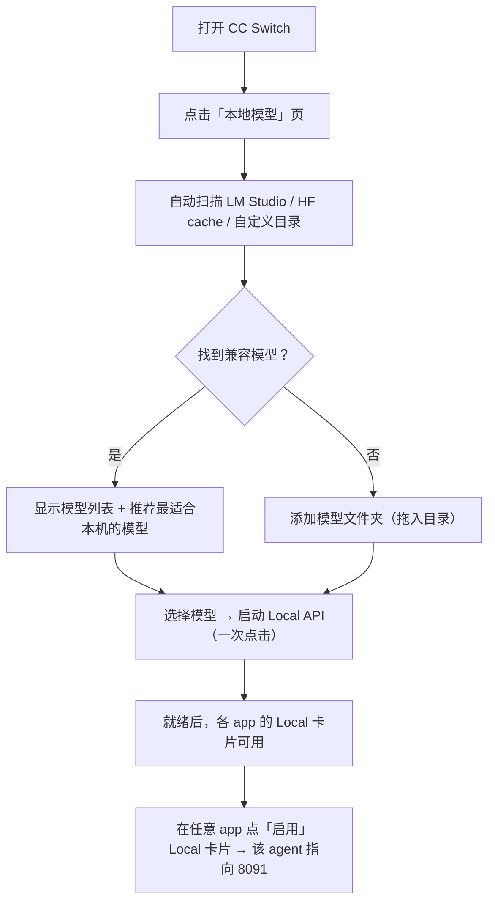
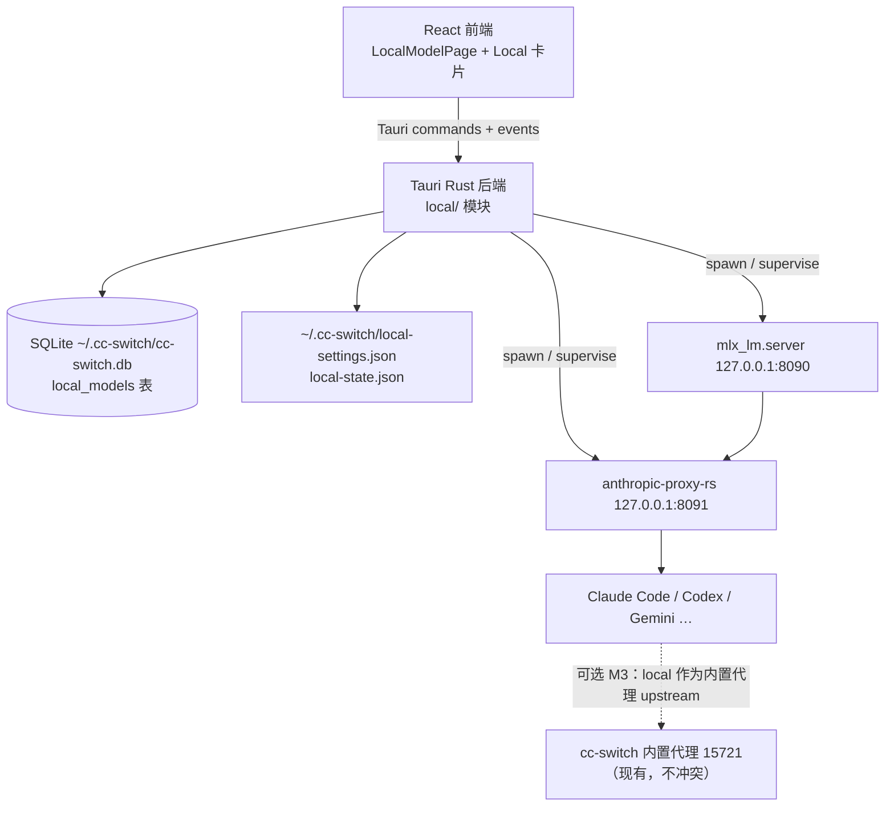
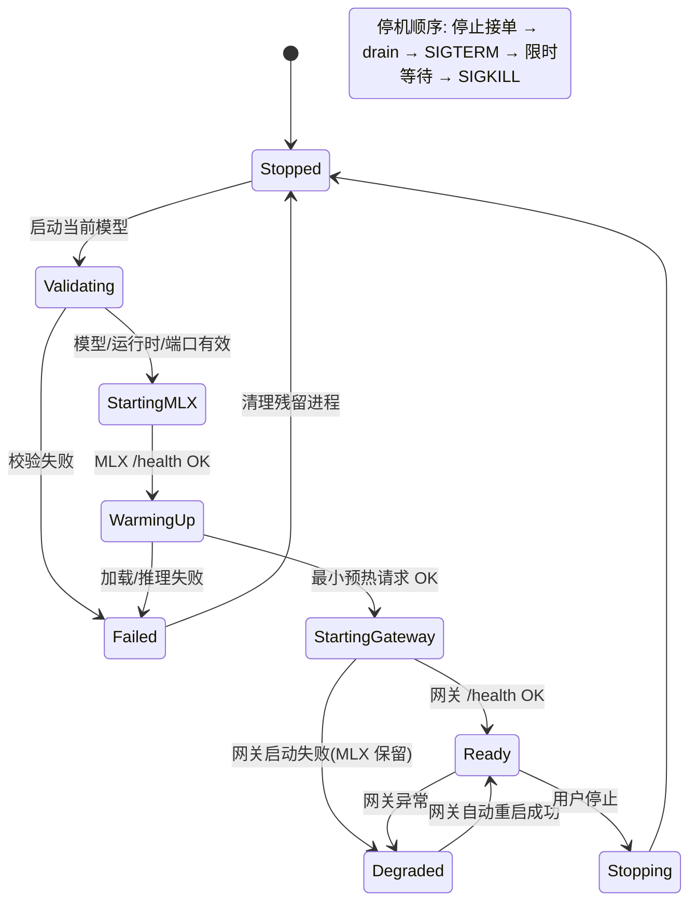

# CC Switch 新版 · 本地模型（Local LLM）集成 Spec

> **文档类型**：Kiro Spec（规格 + 设计决策，开发前评审用）
> **版本**：v0.1（评审稿）
> **状态**：待评审
> **目标版本**：CC Switch **v4.0**（"新版"，本地模型成为一等公民的断代版本）
> **关联仓库**：`cc-switch`（本仓库）、`mlx-gateway-studio`（本地服务链路参考实现）、`anthropic-proxy-rs`（网关组件）、`mlx_lm.server`（推理后端，Python 包）
> **一句话描述**：在 CC Switch 内直接启动**一个**本地 MLX 模型（`mlx_lm.server` + `anthropic-proxy-rs` 双进程），并在**所有 agent 应用的路由列表缺省提供**一个指向该本地服务的 "Local MLX" 供应商卡片。

---

## 1. 背景与问题

CC Switch 目前管理 9 个 agent 应用的**云端**供应商（API Key + Base URL 切换）。本地推理存在几条已验证的链路（见 `mlx-gateway-studio`）：

```
Agent (Claude Code 等)
    │  Anthropic /v1/messages
    ▼
anthropic-proxy-rs  (127.0.0.1:8091)   ← 统一网关：Anthropic 翻译 + OpenAI passthrough
    │  OpenAI /v1/chat/completions
    ▼
mlx_lm.server       (127.0.0.1:8090)   ← MLX 推理，OpenAI 兼容
    ▼
当前 MLX 模型（仅一个）
```

现状问题：

1. **启动本地模型要手写命令**：`python -m mlx_lm.server ...` + `anthropic-proxy ...`，还要配 `UPSTREAM_BASE_URL`、端口、模型名映射、超时。
2. **每换一个 agent 都要手配一次**：Claude Code 写 env、Codex 写 TOML、OpenCode 写 JSON……没有统一入口。
3. **CC Switch 里没有本地模型的影子**：只能配远程 API，本地模型无法进入「一个应用管所有 agent」的心智。
4. 本地模型与云端是否互相备份（本地挂了切云端）没有任何编排。

## 2. 目标（Goals）

| # | 目标 | 成功标准（可验证） |
|---|------|--------------------|
| G1 | CC Switch 能**发现**本机 MLX 模型（LM Studio / Hugging Face cache / 自定义目录） | 打开「本地模型」页即列出本机所有兼容模型目录，含名称、量化、体积、上下文、内存适配 |
| G2 | CC Switch 能**一键启动/停止**本地服务（一个模型） | 一次点击完成双进程启动、健康检查、预热；首页显示就绪 |
| G3 | 所有 agent 应用的供应商路由**缺省**都有 "Local MLX" 卡片 | Claude Code / Desktop / Codex / Gemini / Grok Build / OpenCode / OpenClaw / Hermes / Pi 列表中自动出现 Local 卡片（无需手动添加） |
| G4 | 启用 Local 卡片 = 一次操作（服务未运行则自动先启动） | 点「启用」→ 若停止态则自动启动 → 写入该 app 的 live 配置 → 生效 |
| G5 | 对外连接面稳定：端口、Base URL、模型别名不变 | 切换真实模型后 `http://127.0.0.1:8091` + `default_model` 不变，客户端零重配 |
| G6 | 失败可恢复、可诊断 | 启动失败给出人话原因 + 推荐动作；切换失败自动回滚到上一个可用模型 |
| G7 | 服务生命周期由 CC Switch 托管 | 关闭主窗口服务继续（菜单栏），退出时提示；重启后只接管带 ownership token 的自己进程 |

## 3. 非目标（Non-Goals，本期不做）

- **多模型同时驻留**、模型负载均衡、多路并发推理（严格遵守"仅仅一个"）。
- 局域网 / `0.0.0.0` / TLS / 多用户鉴权暴露（强制 `127.0.0.1`）。
- Hugging Face 在线搜索/下载（沿用「添加模型文件夹」，HF 下载留给未来里程碑）。
- GGUF 转换、LoRA / draft model、量化编辑器、微调。
- 受管可重定位 Python runtime 的**完整套餐**（本期为"检测/配置解释器"；受管 runtime 列入开放问题 OQ-3）。
- 完整聊天工作区、RAG、排行榜。
- 非 macOS 平台的运行时（卡片在这些平台默认隐藏，见 §9）。
- cc-switch 内置代理与本地网关的**深度**编排（failover 队列）——见 M3 里程碑与 OQ-1。

## 4. 术语

| 术语 | 含义 |
|---|---|
| Local API / 本地服务 | 8091 的统一网关（Anthropic + OpenAI 双协议），对外唯一入口 |
| MLX 服务（内部） | 8090 的 `mlx_lm.server`，仅作为网关上游，不直接对用户暴露 |
| `default_model` | 对外稳定模型别名，切换真实模型后不变 |
| Local 卡片 | 各 app 供应商列表中缺省的虚拟 "Local MLX" 卡片 |
| 当前模型 / 正在服务 | 模型库中"下次启动用哪个" / "现在加载的是哪个" |

## 5. 用户故事与关键流程

### 5.1 首次启动（发现 → 启动 → 使用）



**体验预算**：已有可发现模型时 ≤ 3 次主要操作（进入页 → 选模型 → 启动）。

### 5.2 日常使用

| 场景 | 最短流程 | 关键行为 |
|---|---|---|
| 启动服务 | 本地模型页 →「启动 Local API」 | 使用上次模型 + 最后有效配置 |
| 停止服务 | 本地模型页 →「停止服务」 | 有活跃请求先 drain（默认等待，可强制） |
| 切换模型 | 模型列表 →「使用此模型」 | 自动停止旧 → 加载新 → 自测；端点和 `default_model` 不变 |
| 启用 Local 卡片 | 某 app 供应商列表 →「启用」Local 卡片 | 服务未运行则自动启动（用户可取消），再写 live 配置 |
| 关闭窗口 | 点击窗口关闭 | 服务继续运行，App 留菜单栏；`Cmd+Q` 时询问"停止服务并退出 / 取消" |
| 连接 Claude Code | 本地模型页 →「连接 Agent」→ 复制命令 | 复制 `export ANTHROPIC_BASE_URL=... ANTHROPIC_AUTH_TOKEN=...` 一行命令 |

### 5.3 失败恢复

| 失败 | 行为 |
|---|---|
| 端口 8090/8091 被占 | 显示占用进程与推荐空闲端口（8092–8099），「采用并保存」，提醒重新复制连接配置 |
| 模型目录缺失/不完整 | 卡片标「位置不可用」，提供「重新定位」；绝不自动删除外部引用 |
| MLX 启动失败 | 保留 Gateway（若在跑），进入 failed，首页给三段式解释 +「重试」 |
| 新模型加载失败 | 回滚到最后一次可用模型并解释恢复结果 |
| 切换模型时有活跃请求 | 默认「当前请求结束后切换」，可勾选「立即取消并切换」 |

## 6. 产品设计

### 6.1 信息架构

主界面新增全局导航入口「本地模型」（与 MCP / Prompts / Skills 平级），图标：`Cpu`。

```text
┌────────────────────────────────────────────────────────────────────┐
│ 本地模型                          Local API ● 服务可用             │
├────────────────────────────────────────────────────────────────────┤
│ 当前模型                                                           │
│ Qwen3.6-35B-A3B · MLX 6-bit（预估 35 GB）   [更换模型]             │
│ ● OpenAI ✓  Anthropic ✓                                           │
│ http://127.0.0.1:8091                       [连接 Agent] [测试]    │
│ [停止服务] / [启动 Local API]  ← 唯一主按钮，随状态变化            │
│ 内存 48GB  空闲   最近生成 18.4 tok/s                              │
│                                                                   │
│ 模型库   [本地] [添加模型文件夹]                                    │
│  Qwen3.6-35B-A3B          MLX 6-bit   适合本机   [使用]  ← current │
│  Qwen3-8B                 MLX 4-bit   轻量        [使用]           │
│  (…外部引用仅显示「移除引用」，绝不提供磁盘删除)                    │
│                                                                   │
│ 活动   [终端日志…]                                                 │
│ 当前请求 · Claude Code · 03:18  · 20,687 tokens  · [取消请求]      │
│ 00:35  Anthropic  完成  42.7k → 364 tokens   2m11s                 │
└────────────────────────────────────────────────────────────────────┘
```

页面分区（三个主分区，设置走标准设置窗口，高级项折叠）：

1. **状态卡**：当前模型、协议能力、Base URL、主按钮、三项紧凑指标（内存、请求阶段、生成速度）。
2. **模型库**：本地/来源分段、搜索、格式/兼容性/内存适配、行内操作「使用此模型」、拖入目录添加。
3. **活动**：当前/最近请求 + 终端式实时日志（有界环形缓冲）+ 错误建议。

### 6.2 "Local MLX" 供应商卡片（所有 agent 缺省）

**设计决策 ADR-001：Local 卡片以数据库"种子行"形态实现（实施后精化）。**

> **实施说明（M0 落地时修订）**：spec 原案为"纯虚拟合成，不进 providers 表"。
> 实现时发现 `get_effective_current_provider`（settings.rs）会**校验当前供应商必须在
> providers 表中存在**，纯合成会导致 current 解析被清理、热切换/托盘/故障转移等读路径
> 全部需要逐点绕过。因此落地方案改为：**种子行 + 豁免语义**——
> - 启动/`list` 时幂等写入一条 `id="local-mlx"`、`meta.provider_type="local_mlx"` 的种子行
>   （sort_index=0 置顶，icon=cpu，category=local），当前供应商解析天然正确；
> - 用户视角不变：删除被后端拦截（`ProviderService::delete` 对 local_mlx 返回错误），
>   导入/导出与云同步按 provider_type 豁免（M1 落地），不参与 failover；
> - 读写路径只有 `local/providers.rs` 一个入口（build_local_provider / ensure / refresh），
>   settings_config 在每次切换/设置变更时用当前端口与 `default_model` 重新生成。

- 后端在 `list` 时幂等确保种子行（`meta.provider_type = "local_mlx"`，id 固定为 `local-mlx`，`sort_index` 置于最前）。
- 删除被 `ProviderService::delete` 拦截（Local 卡片不可删除）；"导入/导出"与云同步按 provider_type 豁免（M1）；用户隐藏行为记录在 local-settings（`hiddenCards`，device 级）。
- 前端与后端都以 `isLocalMlxProvider(p)` 统一判定，展示"本地"徽标（芯片图标 + 绿色语义色）。
- 卡片状态反映运行时状态：`已停止(可启动) / 启动中 / 运行中 / 需处理`；每 app 在各平台缺省出现。
- 点击「启用」：后端 `switch_provider` 拦截 `local-mlx` —— 服务未运行则**后台启动**（用上次模型），
  就绪后**自动完成切换**并推送 `local-model://auto-switched` 事件；前端 toast 提示"本地服务启动中，就绪后自动切换"；
  服务已就绪则直接写 live 配置（与普通供应商切换走完全相同的 `switch_normal` 路径，享受同等的原子写/回填机制）。

**各 app 的 Local 连接配置矩阵**（端口/别名固定为 8091 / `default_model`）：

| App | 配置载体 | 关键字段 | 协议 |
|---|---|---|---|
| Claude Code | `~/.claude/settings.json` env | `ANTHROPIC_BASE_URL=http://127.0.0.1:8091`；`ANTHROPIC_AUTH_TOKEN=local-not-required`；`ANTHROPIC_MODEL`/`ANTHROPIC_DEFAULT_{HAIKU,SONNET,OPUS}_MODEL=default_model` | Anthropic |
| Claude Desktop | `claude_desktop_config.json` 3P provider | `baseUrl=http://127.0.0.1:8091`、auth token 占位、模型路由 default_model | Anthropic |
| Codex | `~/.codex/config.toml` | `[model_providers.local_mlx] name="Local MLX", base_url="http://127.0.0.1:8091/v1", wire_api="chat"` + auth `OPENAI_API_KEY=local-not-required` | OpenAI chat |
| Gemini CLI | `~/.gemini/settings.json` + env | `GOOGLE_GEMINI_BASE_URL=http://127.0.0.1:8091`、`GEMINI_API_KEY=local-not-required`、`GEMINI_MODEL=default_model` | OpenAI 兼容 |
| Grok Build | Codex 风格 TOML | `base_url=http://127.0.0.1:8091/v1`、`wire_api="chat"`、模型 default_model | OpenAI chat |
| OpenCode | `~/.config/opencode/opencode.json`（additive） | `npm="@ai-sdk/openai-compatible"`，`options.baseURL=http://127.0.0.1:8091/v1`，`apiKey=local-not-required`，`models.default_model` | OpenAI |
| OpenClaw | `models.providers`（additive） | `baseUrl=http://127.0.0.1:8091/v1`、`apiKey=local-not-required`、`models=[default_model]` | OpenAI |
| Hermes | `custom_providers`（additive） | provider `name=local_mlx`、`baseUrl`、`apiKey`、`models[0].id=default_model` | OpenAI |
| Pi | `models.json` providers（additive） | `{name, baseUrl: http://127.0.0.1:8091/v1, apiKey, api:"openai", models:[{id:"default_model", contextWindow…}]}` | OpenAI |

> **验证要求**：上表中除 Claude Code 外均为"按现有预设形状生成"（参考 `src/config/*ProviderPresets.ts` 与 `codexTemplates.ts`）；Gemini`OPENAI_COMPATIBLE` 变量名、Codex `wire_api="chat"` 在本地端点的实际行为属于 M0 必须验证项（见 §12 OQ-8）。

### 6.3 连接 Agent Sheet

- 从状态卡打开，提供：**Claude Code**（完整复制并启动命令）、**OpenAI Compatible**（curl / SDK 示例）、**Codex / Gemini / OpenCode / OpenClaw / Hermes / Pi** 分标签给出该 app 的配置片段。
- 所有片段只读展示 + 一键复制；"写入某 app 配置"一律走 Local 卡片启用流程（受确认与备份保护）。
- 明确标注：服务自测成功 ≠ Claude Code 已验证；后者必须收到一条真实客户端请求（同 studio 契约）。

## 7. 技术设计

### 7.1 总体架构



- 后端新增模块 `src-tauri/src/local/`（见 7.2），不侵入现有 `services/provider/` 主链路；Local 卡片在 `provider` 读路径上做**薄注入**（ADR-001）。
- 子进程直接以 argv 启动（不经 shell），最小环境 allowlist + 专用 working directory（同 studio 契约）。

### 7.2 后端模块划分

```
src-tauri/src/local/
├── mod.rs            # 模块导出、LocalServiceState（全局单例，RwLock）
├── discovery.rs      # 模型扫描：LM Studio/HF cache/自定义目录；metadata 解析（移植 studio ModelMetadataParser + DiscoveryEngine）
├── model.rs          # LocalModelRecord（serde 结构），SQLite DAO
├── settings.rs       # LocalSettings 读写（~/.cc-switch/local-settings.json，schemaVersion + 原子写）
├── coordinator.rs    # 进程监督状态机（移植 studio RuntimeCoordinator 语义，tokio::process::Command + tokio::select）
├── health.rs         # /health、/v1/models、预热请求、端口探测
├── logs.rs           # 有界环形日志（内存 ring buffer，供前端流式拉取）
├── metrics.rs        # 进程 RSS/CPU 采样（macOS ps/sysctl），网关 /studio/metrics 快照
└── providers.rs      # Local 卡片合成：按 AppType 生成 Provider + settings_config（含每 app 模板）
```

**主要新 Tauri 命令**（注册进 `commands/local.rs`，前端 `src/lib/api/local.ts` 封装）：

```ts
local_models_list()            -> LocalModelRecord[]
local_models_rescan()
local_models_add_root(path)    -> { added: boolean }
local_models_remove_ref(path)
local_service_start(modelPath) -> LocalServiceStatus   // 幂等：运行中直接返回
local_service_stop(force?: boolean)
local_service_status()         -> LocalServiceStatus    // polling
local_service_logs(sinceId)    -> LogEntry[]
local_service_test(protocol)   -> { ok, latencyMs, model, message }
local_service_metrics()        -> ServiceMetrics
local_settings_get() / local_settings_set(patch)
local_card_visibility(app, hidden)   // 按 app 隐藏 Local 卡片
```

**状态事件**：`emit("local-model://status", LocalServiceStatus)` 全量状态变更推送（前端 `useTauriEvent` 已有同款模式）；日志用增量 `(sinceId)` 轮询 + 事件触发的轻量拉取，避免高频 IPC。

### 7.3 进程监督契约（本地服务状态机）



规则（移植并沿用 studio 已验证语义）：

1. **单协程串行**：所有 start/stop/switch 经单一 `tokio::sync::Mutex` 串行化，杜绝连点竞态。
2. **Ownership**：每次 spawn 记录 `{pid, start_time, exec_path, random_token, port}` 到 `local-state.json`（原子写）。App 重启发现 legacy 进程时，只有 ownership token 与可执行路径、启动时间全部匹配才接管；陌生端口占用绝不自动杀。
3. **端口检查只作提示**：以真实 bind 结果为准；冲突时推荐采用 8092–8099 稳定端口并持久化。
4. **切换模型不重启网关**：只停 MLX（drain 后 TERM），网关进程保持，`/studio/metrics` 观察连续。
5. **取消传播**：客户端断开/BrokenPipe 只取消对应上游请求，不影响其他请求。
6. **sleep/wake**：唤醒后重新健康检查，标记被中断请求。

### 7.4 端口 / 别名 / 启动参数契约

| 项 | 值 | 说明 |
|---|---|---|
| MLX 内部端口 | `8090`（127.0.0.1） | 仅网关访问；高级页可见 |
| 网关端口 | `8091`（127.0.0.1） | 所有 agent 的 Base URL |
| 对外模型名 | `default_model` | Claude 角色名自动映射；`/v1/models` 返回的 ID 与连接向导一致 |
| 内置代理预留 | `15721` | 现有 cc-switch 代理端口，不冲突（OQ-1 涉及） |

**mlx_lm.server 启动参数**：

```
{python} -m mlx_lm.server --model {path} --host 127.0.0.1 --port 8090
  --max-tokens {per-model fallback，默认 4096}
  --prefill-step-size 2048
  --prompt-cache-size {按物理内存推荐: 96G+→12, 48G+→8, 24G+→6, else 4}
  --prompt-cache-bytes {按模型工作集推荐，半 GiB 对齐}
  --prompt-concurrency 1 --decode-concurrency 1
  --log-level INFO
env: PYTHONUNBUFFERED=1
```

**anthropic-proxy-rs 启动参数**：

```
{proxy} --bind 127.0.0.1 --port 8091
env: UPSTREAM_BASE_URL=http://127.0.0.1:8090/v1
     UPSTREAM_TIMEOUT_SECS=172800
     ANTHROPIC_PROXY_BIND=127.0.0.1
     COMPLETION_MODEL=default_model
     REASONING_MODEL=default_model
     HOME={cc-switch data dir}   # 防止读到用户 ~/.env
```

### 7.5 模型发现（port 自 studio）

- 根目录：`~/.cache/lm-studio/models`、`~/Library/Application Support/LM Studio/models`、`~/.cache/huggingface/hub`（按 HF snapshot 语义扫，去重 symlink/blob）、用户自定义根目录。
- 有效性：目录含 `config.json` + 至少一个 `*.safetensors`；解析 `model_type`、`max_position_embeddings`、量化位数、tokenizer/chat template 存在性；按文件大小求和。
- 内存适配分级：`comfortable / tight / tooLarge`（物理内存 - 模型工作集估算）。
- **只读引用**：绝不复制/移动模型文件；UI 只提供"移除引用"。
- 验证分级（惰性执行并按指纹缓存）：① 元数据完整 ② 可加载最小推理 ③ chat template 可用 ④ 工具调用通过 ⑤ Claude Code 真实请求。

### 7.6 数据模型与持久化

**SQLite 新表 `local_models`**（migration 加表，不动现有表）：

```sql
CREATE TABLE IF NOT EXISTS local_models (
  path TEXT PRIMARY KEY,             -- 绝对路径（resolved）
  name TEXT NOT NULL,
  source TEXT NOT NULL,              -- lm_studio | hugging_face | custom
  size_bytes INTEGER NOT NULL,
  model_type TEXT, quantization TEXT,
  context_length INTEGER, kv_bytes_per_token INTEGER,
  has_tokenizer INTEGER, has_chat_template INTEGER,
  memory_fit TEXT NOT NULL,
  verify_level INTEGER DEFAULT 0,    -- 0-5 分级验证
  fingerprint TEXT,                  -- 配置/权重指纹，变化即失效重验
  last_used_at INTEGER,
  notes TEXT
);
```

**`~/.cc-switch/local-settings.json`**（schemaVersion + 原子写 + 备份轮换，沿用现有 JSON 工具）：

```json
{
  "schemaVersion": 1,
  "pythonPath": "",                  // 空=自动探测链
  "proxyPath": "",                   // 空=优先 bundled，其次 ~/.local/bin/anthropic-proxy
  "customModelRoots": [],
  "host": "127.0.0.1",
  "mlxPort": 8090,
  "gatewayPort": 8091,
  "maxTokensFallback": 4096,
  "prefillStepSize": 2048,
  "automaticPromptCache": true,
  "promptCacheSize": 4,
  "promptConcurrency": 1,
  "decodeConcurrency": 1,
  "upstreamTimeoutSecs": 172800,
  "modelOverrides": { "<path>": { "contextBudget": null, "maxTokens": null } },
  "autoStartWithApp": false,
  "keepRunningOnQuitPrompt": true,
  "hiddenCards": { "claude": false, "codex": false }
}
```

**`~/.cc-switch/local-state.json`**：运行时 ownership 记录 + 最后可用模型快照（失败回滚用），仅进程管理模块读写。

**探测链（pythonPath 为空时）**：`MLX_GATEWAY_PYTHON` env → `<parent of app>/../.venv/bin/python`（开发态）→ `~/.local/share/cc-switch/runtime/**/bin/python`（未来受管 runtime）→ `~/miniconda3/bin/python`/`conda`（本机现状，保证开箱即用）。探测结果展示在设置页"运行时"并允许改写。

### 7.7 前端

- `types.ts`：`LocalModelRecord`、`LocalServiceStatus`（state 枚举与 studio 对齐：`stopped/validating/startingMlx/warmingUp/startingGateway/ready/degraded/stopping/failed`）、`LocalLogEntry`。
- `src/config/localMlxPresets.ts`：每 app 的 Local settings_config 模板（§6.2 矩阵的代码化），供后端 `providers.rs` 与前端"连接 Agent"共享同一份常量（前后端各一份、配 contract 测试防漂移，或生成至 `src-tauri/resources`——实现时二选一，见 OQ-7）。
- 新视图 `view: "local"`（App.tsx 的 `View` 联合类型 + VALID_VIEWS + i18n keys zh/zh-TW/en/ja）。
- 组件：`local/LocalModelPage.tsx`（状态卡/模型库/活动）、`local/LocalServiceCard.tsx`、`local/ConnectionSheet.tsx`、`providers/LocalProviderBadge.tsx`。
- Provider 列表：`ProviderList` 顶部插入 Local 卡（后端合成，前端只按 `providerType` 渲染徽标）；点击"启用"走现有 `providersApi.switch`（后端识别 local-mlx 时先确保服务启动）。
- Local 页在非 macOS 平台默认隐藏（settings 可改为显示"当前平台不支持"）。

### 7.8 与现有系统的边界

| 现有系统 | 本期关系 |
|---|---|
| providers CRUD / 切换 / 回填 | Local 卡片复用写入路径；不进 DB、不参与备份/导出/云同步（ADR-001） |
| 内置代理（15721）+ Failover | **M3 单独里程碑**：把 Local 网关作为 upstream 之一接入代理路由队列（本地优先 / 本地 fallback 两种模式）；MVP 不实现（OQ-1） |
| 用量统计 | MVP 仅通过 `/studio/metrics` 展示请求数/流量；不写 usage 表（本地 0 成本）；M3 再决定是否入统一 dashboard |
| MCP / Prompts / Skills / Sessions | 无关联，不受影响 |
| 云同步（WebDAV/S3） | 不含 local_models 与 local-settings（本机路径不可移植） |
| 热切换（Claude Code 现成） | Local 卡片启用同样享受不用重启终端的 hot-switch 路径 |

## 8. 错误处理与可观测性

- **三段式错误**（首页）：`发生了什么 → 是否影响当前请求/模型 → 推荐动作（重试/采用端口/重新定位）`；PID/堆栈/原始 stderr 只进"技术详情"。
- **日志**：服务名 + 时间 + 级别 + 关联请求 ID；环形缓冲固定容量（比如 2000 行）支持"复制最近 200 行"；默认脱敏 Authorization/Cookie/token；正文不落盘。
- **诊断包**：脱敏 local-settings、版本矩阵（mlx-lm/mlx/proxy）、端口与 ownership、最近日志。
- 必须可诊断的失败清单：端口占用、模型目录不完整/不兼容/磁盘不足、python 缺 `mlx`/`mlx-lm` 版本不匹配、MLX 进程崩溃 + OOM、网关上游错误/流中断/超时、客户端断开但上游继续、睡眠唤醒半连接、PID 复用。

## 9. 平台与分发

| 平台 | 行为 |
|---|---|
| macOS 14+ Apple Silicon | 完整功能 |
| macOS Intel / 其他 | 本地模型页隐藏；Local 卡片不出现（settings 有显示开关则显示"不支持"） |
| Windows / Linux | 同上；代码路径隔离在 `cfg(target_os = "macos")` + 前端平台判断 |

**外部组件交付**：

- `anthropic-proxy-rs`：固定 commit/版本构建（`scripts/build-anthropic-proxy.sh`，产物约 3MB），放入 `src-tauri/resources/anthropic-proxy` 随包分发；发布时登记版本到 `THIRD_PARTY_NOTICES`。
- `mlx_lm`：不随分发（Python 包）。版本验证范围：mlx-lm 0.31.x / mlx 0.32.x（本机已验证组合）；设置页展示检测到的版本与"兼容"判断。

## 10. 测试策略与验收

| 级别 | 内容 |
|---|---|
| Rust 单元 | discovery 解析（fixture 目录）、每 app Local settings_config 生成、状态机（fake process/HTTP/clock）、ownership 接管判定、端口冲突策略 |
| 集成 | 真实双进程启动 → health → /v1/models → 预热 → 网关就绪；停止/drain；切换模型端到端不变；错误注入（端口抢占、模型缺失、进程被杀） |
| 前端 | Local 卡片渲染/状态、隐藏开关、i18n、连接 Sheet 复制内容快照 |
| 契约 | 每 app live 文件写入后的解析回读（Claude settings.json、Codex TOML、OpenCode JSON） |
| 手工验收 | 见下表 |

**已完成定义（M0 纵切）**：选择本机已有 Qwen MLX 模型 → 点击一次启动 → 首页同一 Local API 状态 → Claude Code 用 `default_model` 完成一次真实工具调用 → 客户端取消后计算停止 → 切换无效模型自动恢复 → 关闭窗口后服务在菜单栏继续。

## 11. 里程碑

| 里程碑 | 内容 | 状态 |
|---|---|---|
| **M0 纵切** | 后端 `local/` 骨架；双进程启动/停止/健康/预热；Claude Code Local 卡片启用打通（含 live 写入）；i18n 骨架 | ✅ 完成（2026-08-31 验证：ready / `/v1/messages` / Claude CLI PONG / tool-use 全过） |
| **M1 完整本地页** | 模型发现（三来源 + 自定义目录）、模型库 UI、内存适配/上下文展示、全 app Local 卡片与配置生成 | 🚧 进行中（Claude + Claude Desktop 卡片已通；其余 app 待接入） |
| **M2 体验收口** | 日志/指标活动页、测试请求 Sheet、`default_model` 映射与连接向导、失败回滚、ownership 重启接管、设置页"运行时" | 未开始（日志/指标页已提前实现雏形：诊断面板 + 调试信息窗口） |
| **M3 可选编排** | 内置代理接入 Local upstream（本地优先/failover）、用量 dashboard 显示本地请求 | 未开始 |

### 11.1 已解决的关键问题（调试记录）

| 问题 | 根因 | 修复 |
|---|---|---|
| app 内 spawn 的 mlx_lm.server 立即死亡（转储无 stderr） | `launch_mlx`/`launch_gateway` 未设置 `Stdio::piped()` → 子进程继承已失效的父 stdout 管道，写出即死；`pipe_output` 永远读不到内容 | 显式 `.stdout(piped()).stderr(piped())` |
| 端口预检漏判 "wedged" 实例（accept 后不响应 `/health`，如 stdout 断裂致每请求 BrokenPipeError → Empty reply） | 预检用 HTTP 探活，探活失败即跳过回收 → 新进程 bind 失败 | 预检改用 `lsof -sTCP:LISTEN` 实际监听者（`port_listener_pids`），有监听者即尝试回收 |
| Release 版（/Applications）spawn 的 mlx_lm.server 永久挂起（~12MB RSS、无 socket，sample 显示卡在 `getpath_readlines → fopen → open$NOCANCEL`，120 次健康检查全失败） | **macOS TCC**：venv 原本在 `~/Documents/PythonPrj/.../.venv`（Documents 是 TCC 保护目录）。Release app（`com.ccswitch.desktop`）无 Documents 授权 → python 启动读 `pyvenv.cfg` 时 `open()` 阻塞等待系统授权弹窗（headless 永久挂起）；Dev 版之所以正常是继承了启动它的终端授权 | venv 迁到非保护目录（`cp -R ~/Documents/.../.venv ~/.mlx-lm-venv`，343MB 可复制）；`validate()` 对 `python_path` 与模型路径加 TCC 保护目录检测（`is_tcc_protected_path`）并快速报错而非挂起；`detect_python_path` 优先探测 `~/.mlx-lm-venv` |
| 模型库 UI 显示 NaN/undefined | `LocalModelRecord` 缺 `rename_all`，序列化 snake_case，前端读 camelCase | 加 `#[serde(rename_all = "camelCase")]`（DB 列名不受影响） |

## 12. 风险与开放问题（需评审确认）

| ID | 问题 | 我的建议 |
|---|---|---|
| OQ-1 | Local 网关是否接入 cc-switch 内置代理的 failover 队列（本地优先/云端备份）？ | **已确认：MVP 直连 8091，M3 再接 failover** |
| OQ-2 | Local 卡片按 app 隐藏 vs 全局隐藏？ | 按 app 隐藏（与 visibleApps 一致），默认全显示 |
| OQ-3 | 受管可重定位 Python runtime 何时做？ | M2 之后（本期探测链已覆盖本机 .venv/miniconda） |
| OQ-4 | 是否随包分发 anthropic-proxy 二进制？ | 是（+3MB 换零配置；构建脚本进 CI） |
| OQ-5 | 默认端口 8090/8091 与现有 studio 冲突处理？ | 检测到占用时提示采用 8092–8099 并持久化（与 studio 一致） |
| OQ-6 | Claude Desktop 是否进 MVP？ | 进（复用现有 Desktop 3P 机制，同 Claude Code 字段） |
| OQ-7 | 每 app 模板前后端如何共享？ | 模板放 `src-tauri/resources/*.json`，前端从后端取（单一事实源）+ contract 测试 |
| OQ-8 | Gemini `GOOGLE_GEMINI_BASE_URL`、Codex `wire_api="chat"` 对本地端点的真实行为 | M0 用本机 8091 实测验证；失败则用该 app 的 OpenAI-compat 替代通道或降级为"仅连接命令" |
| OQ-9 | "新版"号段：3.20 vs 4.0？ | **已确认：4.0**（本地模型成为一等公民的断代版本） |
| OQ-10 | 本地模型是否参与"最近使用/排序"与用量？ | 本地请求不计费；M3 再纳入 dashboard |

---

*附：实现参考文件索引*
- 双进程/健康/预热语义：`mlx-gateway-studio/Sources/MLXGatewayStudio/Runtime/RuntimeCoordinator.swift`
- 发现/元数据解析：`…/Models/ModelDiscovery.swift`、`ModelMetadataParser.swift`
- 每 app 写入路径：`cc-switch/src-tauri/src/services/provider/live.rs`（`write_live_snapshot`）
- 预设形状：`cc-switch/src/config/{claude,codex,gemini,grokbuild,opencode,openclaw,hermes,claudeDesktop}ProviderPresets.ts`
- 网关路由：`anthropic-proxy-rs/src/main.rs`（`/v1/messages`、`/v1/chat/completions`、`/health`、`/studio/metrics`）
